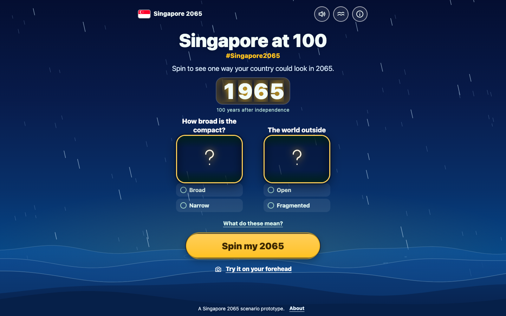

<p align="center"></p>

# Singapore 2065: spin your future

A two-minute scenario game. Two dials (who shares in the gains, and whether the world outside stays open) land you on one of four possible Singapores in the year of its centenary, **9 August 2065**. Spin, or **pick your own dials**. Read that future's front page, react with a selfie, emoji or voice, and share it as a picture or a short video. **#Singapore2065**

> Scenarios are imagined, not forecasts. All characters are fictional. Pictures are AI-generated illustrations.

**Play:** https://tinyurl.com/Singapore2065 &nbsp;|&nbsp; **Version:** 0.4.0 (prototype, for discussion) &nbsp;|&nbsp; **Languages:** English, 中文, Bahasa Melayu, தமிழ் (translations are drafts)

## The four futures
| | Open world | Fragmented world |
|---|---|---|
| **Gains shared by many (broad compact)** | A. Open Commons | B. Lifeboat Republic |
| **Gains shared by few (narrow compact)** | C. Gilded Hub | D. Garrison City |

Each future has a headline, a front page (lead story, "on the street" story, voices, letters, comment), a path of four turning points, questions for readers, and a row in a numbers table. See [documentation/CONTENT-AND-SOURCES.md](documentation/CONTENT-AND-SOURCES.md).

## Features
- Spin, **choose your own dials**, press **Space**, or use the **forehead card** camera mode; share a **1080 x 1350 picture** or a short video through the phone's share sheet
- Selfie, voice and emoji reactions stay on the phone; nothing is uploaded
- Full newspaper front pages, numbers and common-ground pages in the app, and a **print** button for the front pages
- Water, rain and fireworks background; motion turns off for people who ask for less, and there is an on/off button; optional vibration setting
- Works offline after the first visit and can be added to the home screen (hosted build)
- Consent-first analytics (Google Analytics 4) and a two-question feedback form. See [documentation/ANALYTICS.md](documentation/ANALYTICS.md)

## Two builds, one source
| Folder | What it is | Use it for |
|---|---|---|
| `docs/` | `index.html` (about 280 KB) with pictures loaded only when needed, an install manifest and an offline service worker | **GitHub Pages**, any web host |
| `dist/` | one self-contained `index.html` (about 2.2 MB) with everything embedded | **itch.io**, a USB stick, double-clicking from your computer |

## Run it
```bash
python3 build.py                              # builds docs/ and dist/ from src/
python3 -m http.server -d docs 8000           # then open http://localhost:8000
python3 tests/smoke_test.py                   # needs: pip install playwright && playwright install chromium
```
Camera, microphone, sharing and offline need `https://` or `localhost`. To publish, see [documentation/DEPLOY.md](documentation/DEPLOY.md).

## What is in the repository
```
src/            template.html (the app), content.json (four futures, four languages), ui.json (interface text), site.json (front-page pages), img/ (28 WebP pictures), assets/ (app icons)
docs/           built site for hosting (GitHub Pages serves this folder), plus cover and social-preview images
dist/           built single-file site
documentation/  analytics plan, deployment, privacy notice draft, content and sources, image register, design review, licensing
tests/          smoke_test.py (Playwright): both builds, every language
tools/          convert_images.py (large originals to small WebP)
config.json     baseUrl for link previews; version for the offline cache
build.py        builds both; --check fails if they are out of date; --mode pages|single
```

## Change something
- **Wording of a future:** `src/content.json`. Card-level text is translated into four languages; the long front-page text (`lead`, `street`, `side`, and `full`) is English only for now and shown with a note in the other languages.
- **Interface text or a new language:** add a block to `src/ui.json` and `src/content.json`, one entry to `LANGS` in `src/template.html`, then `python3 build.py`.
- **Pictures:** `python3 tools/convert_images.py FOLDER_OF_ORIGINALS`, then update the `alt_*` picture descriptions in `src/ui.json`.
- **Analytics ID, share link, app version:** the `CONFIG` block near the top of the script in `src/template.html`.

## Privacy, accessibility and cautions
- Statistics are **off until the visitor taps Allow**; both choices look the same; Do Not Track is respected. Draft notice: [documentation/PRIVACY-NOTICE-DRAFT.md](documentation/PRIVACY-NOTICE-DRAFT.md). Have your data-protection team approve it before launch.
- Accessibility: automated audit (axe-core, WCAG 2.2 AA plus best practice) found **no violations** in the start, dial, result, "tell me more", front-page, numbers and feedback states. Status and remaining items: [documentation/DESIGN-REVIEW.md](documentation/DESIGN-REVIEW.md).
- **Translations (中文, Bahasa Melayu, தமிழ்) are drafts** and must be reviewed by native speakers before release.
- Scenario text about politics and consent is fictional and names no real person or party. Have it read by someone with local knowledge before wide release.

## Credits
Built on the engine of the **Pakistan 2047** randomiser (spin, selfie, forehead card, share). Pictures generated with Leonardo.ai from the prompts in [documentation/IMAGES.md](documentation/IMAGES.md). Facts: Singapore Population in Brief 2026, PUB, Third National Climate Change Study (V3); see the sources file.

## Licence
Not chosen yet. See [documentation/LICENSING.md](documentation/LICENSING.md) before making this repository public.
